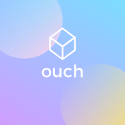

<div align="center">



# Ouch

**Painless compression and decompression**

[](https://snapcraft.io/ouch)
[](https://snapcraft.io/core26)

[](https://snapcraft.io/publisher/sidaliteir)


[Getting Started](#getting-started) · [Configure](#configure) · [Limitations](#limitations) · [Build](#build) · [Support](#support) · [License](#license)

Unofficial snap packaging for [Ouch](https://github.com/ouch-org/ouch), a command-line tool for creating and extracting archives.

</div>

---

## Getting Started

<a href="https://snapcraft.io/ouch"></a>

```bash
sudo snap install ouch
ouch compress ./my-dir ./my-dir.tar.zst
ouch decompress ./my-dir.tar.zst --dir ./restored
```

Ouch selects the compression format from the archive's file extension.

## Configure

There are no `snap set` options. Choose the archive name, input files and output directory on the command line. Use `ouch --help`, `ouch compress --help` or `ouch decompress --help` for available options.

To work with archives under `/media` or `/mnt`:

```bash
sudo snap connect ouch:removable-media
```

## Limitations

- Work in a normal folder under your home directory or connected removable storage.
- Hidden files directly under your normal home directory and arbitrary system paths are inaccessible under strict confinement.

## Build

```bash
git clone https://github.com/sidalit/ouch-snap.git
cd ouch-snap
sudo snap install snapcraft --classic
snapcraft pack
```

## Support

- **Installation or snap issues:** [open a packaging issue](https://github.com/sidalit/ouch-snap/issues).
- **Application bugs:** [report them upstream](https://github.com/ouch-org/ouch/issues).

## License

Snap packaging: [MIT](https://github.com/sidalit/ouch-snap/blob/main/LICENSE).
